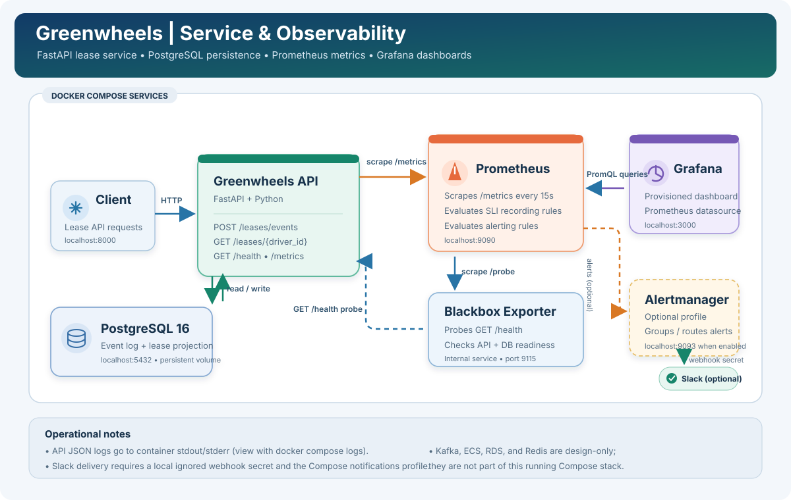

# Greenwheels Fleet Lease Service

FastAPI service for recording lease events and serving each driver's current
lease projection. PostgreSQL stores the event history and projection;
Prometheus and Grafana provide metrics and dashboards.

## Architecture



Alertmanager and Slack notifications are optional and require local webhook
configuration. Kafka, ECS, RDS, and Redis are described as future scale-design
options, not as components in the current Compose deployment.

## Run the full stack

Requirements: Docker Desktop with Docker Compose enabled.

If you do not already have a local `.env`, copy the example:

```powershell
Copy-Item .env.example .env
```

Start the services from the repository root:

```powershell
docker compose up --build -d
docker compose ps
```

The API is available at <http://localhost:8000>, Prometheus at
<http://localhost:9090>, Grafana at <http://localhost:3000>, and (when enabled)
Alertmanager at <http://localhost:9093>. API startup waits for PostgreSQL and
creates any missing application tables. The API health check becomes healthy
only after PostgreSQL is reachable.

Prometheus evaluates the rules in `monitoring/prometheus/alerting_rules.yml`,
including lease-event 5xx rate, the API latency SLO, and an external probe of
`/health` that also checks database readiness. To enable Slack notifications,
create a Slack Incoming Webhook and store its URL in the ignored local secret
file, then start the notifications profile:

```powershell
New-Item -ItemType Directory -Force .secrets
Set-Content -NoNewline .secrets\slack_webhook_url '<your Slack Incoming Webhook URL>'
docker compose --profile notifications up --build -d
```

The webhook is read from `.secrets/slack_webhook_url` by Alertmanager and is
not stored in `.env` or committed to Git. Without this file and profile,
Prometheus still evaluates and displays firing alerts, but Slack delivery is
disabled. Alert definitions include triage actions and links into `RUNBOOK.md`.

Submit an event with `POST /leases/events`, retrieve a driver's projection
with `GET /leases/{driver_id}`, and check API readiness at `/health`.

To follow startup logs:

```powershell
docker compose logs -f api postgres
```

For incident triage steps, see [RUNBOOK.md](./RUNBOOK.md).
For the proposed four-engineer on-call and escalation model, see
[ONCALL.md](./ONCALL.md).
For the scale-exercise design (Kafka, RDS read scaling, caching, lag recovery,
and ECS deployment reliability), see [ARCHITECTURE.md](./ARCHITECTURE.md).

Stop the services without deleting persistent data:

```powershell
docker compose down
```

## Test

```powershell
.\.venv\Scripts\python.exe -m pytest
```

Tests use an in-memory SQLite database by default and can use PostgreSQL by
setting `DATABASE_URL` in the process environment before running pytest.
